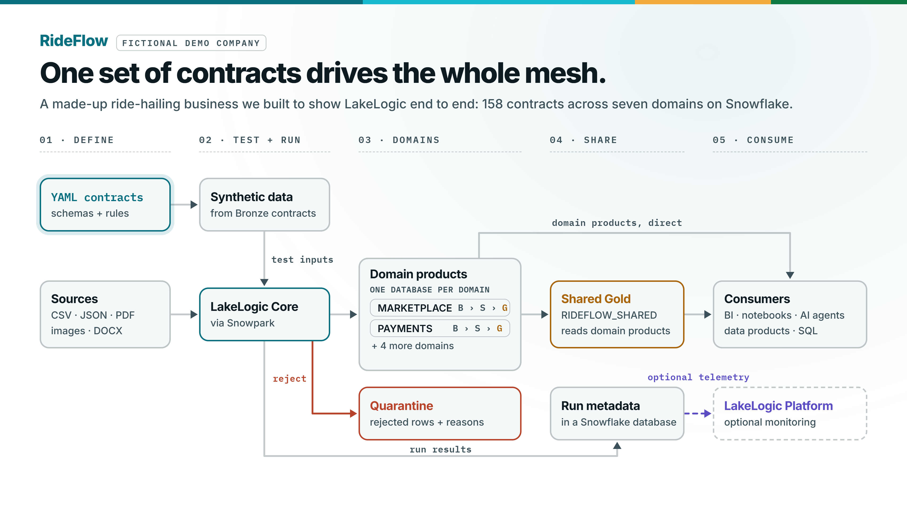
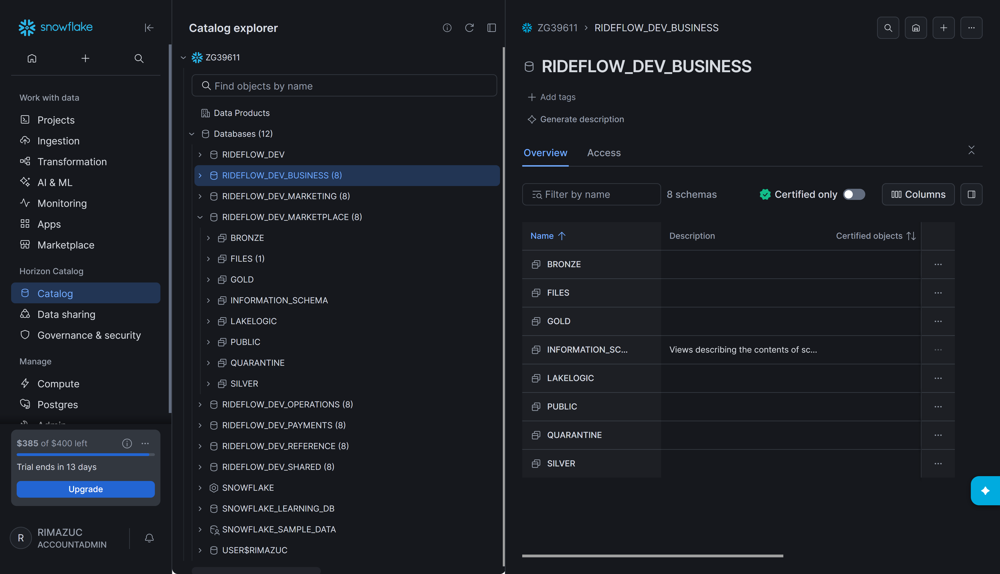
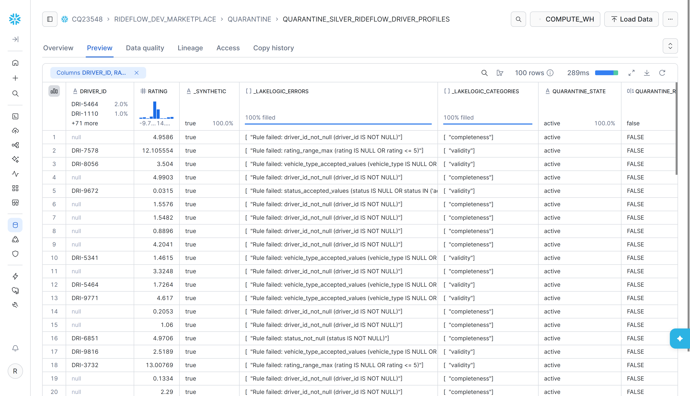

# Architecture and reference

[Back to the quickstart](../README.md)

Detailed examples and repository layout for the RideFlow reference lakehouse on Snowflake.

> Current inventory: 158 contracts across seven domains, including Business/Salesforce. There are 14 source-system trees plus the Shared registry. The contracts are identical to the [Databricks reference project](https://github.com/LakeLogic/lakelogic-rideflow-databricks-governed-lakehouse); only `_system.yaml` platform settings and `platform/snowflake/` differ.

## Domain boundaries

```text
RideFlow · one Snowflake account · 7 domains · 14 source systems plus Shared
Source-processing domains use the medallion pattern — Bronze (raw, all-string, schema-flexible) → Silver (typed, cleaned, transformed, validated) → Gold (products)
│
├── Marketplace   (rideflow)                          ← shown expanded as the example
│   ├── Bronze   raw · all-string · schema-flexible (evolves, keeps everything)
│   │     driver_profiles · rider_profiles · driver_telemetry · rider_app_events
│   │     trip_requests · trip_completed · trip_cancellations
│   ├── Silver   typed, cleaned, deduped, transformed, validated
│   │     driver_profiles · rider_profiles · trips (joined) · trip_requests
│   │     driver_telemetry · rider_app_events
│   └── Gold   business products
│         dim_driver · dim_rider (SCD2) · code dims (trip_type, vehicle_type, …)
│         fact_trip_completed · fact_trip_requests · fact_trip_cancellations
│         fact_driver_telemetry · fact_rider_app_events
│
├── Payments     (stripe · driver_expenses)                        →  Bronze → Silver → Gold
├── Operations   (checkr · onboarding · trust_safety · twilio · zendesk)  →  Bronze → Silver → Gold
├── Marketing    (google_ads · google_analytics · hubspot · meta_ads)     →  Bronze → Silver → Gold
├── Business     (salesforce)                                      →  Bronze → Silver → Gold
├── Reference    (internal)      →  Bronze → Silver → Gold   ·  cities, fx rates
└── Shared       (cross-domain marts)   →  Gold   ·  products that join every domain
```

<picture>
  <source media="(prefers-color-scheme: dark)" srcset="images/rideflow_architecture_dark.png">
  
</picture>

Source-processing domains own their Bronze, Silver and Gold definitions. Shared settings
are inherited from `_domain.yaml` and `_system.yaml`; each contract keeps its
dataset-specific rules beside the team that understands the data. Shared Gold
products read other domains' outputs directly and own no sources.

The 158 contracts cover CSV, JSON, PDF, image and Word input, external Python logic,
cross-domain Gold products, row-level lineage tags, freshness and volume SLOs, and SCD
Type 2 dimensions (tracked columns, surrogate keys, effective dates, current-version
flags and an unknown member).

## Data flow

Source files land on each domain's internal stage, `RIDEFLOW_DEV_<DOMAIN>.FILES.LANDING`,
one folder per system. Bronze loads them with `COPY INTO` through a landing table
(`FILES.LL_LANDING_<ENTITY>`). Snowflake's load history skips files it has already
loaded, so a rerun with no new files loads nothing. To reload every file, set
`LAKELOGIC_RELOAD_LANDING=true`.

Bronze keeps rows raw and all-string. Silver types, cleans and validates them, and
merges on the contract's key. Gold builds the products. Each layer's SQL runs in the
warehouse and writes in place; rows are not pulled into the notebook.

Quarantine is a failure path, not another layer. A row that fails a rule goes to
`QUARANTINE.QUARANTINE_<TABLE>` with the rule it failed (`_LAKELOGIC_ERRORS`) and its
category, while valid rows continue. Dataset gates can still stop an unsafe run.

## Dependency execution

Contracts declare `depends_on` edges. LakeLogic builds the graph and processes products
in dependency order, including dependencies within one layer. Contracts in the same
wave run in parallel, each on its own Snowflake session (`LAKELOGIC_PARALLEL_CONTRACTS`,
default 8).

Each system has one task graph that runs its Bronze, Silver and Gold stages. The
`pl_data_00_mesh_orchestrator` task graph runs those systems in dependency order:
Business and Reference first, then the systems that read them, then Shared. Synthetic
seeding is separate: run `pl_test_synthetic_seed` first when there are no landing files.

## Deployed resources

`platform/snowflake/deploy/deploy_project.py` creates these from the Git repository
object. Notebooks run on the `RIDEFLOW_POOL` compute pool; SQL runs on `RIDEFLOW_WH`.

```text
Platform database: RIDEFLOW_DEV
└── "pipeline"            Git repository object, notebooks, tasks, the wheels and
                          lakelogic_logs stages, and the erasure_requests table

One database per domain: RIDEFLOW_DEV_<DOMAIN>
├── FILES.LANDING         Internal stage of inbound source files, one folder per system
├── BRONZE                Bronze tables
├── SILVER                Silver tables
├── GOLD                  Gold tables
├── QUARANTINE            Contract-failing rows, created on the first rejected row
└── LAKELOGIC             Run log, SLO results, retention and erasure records

Domains: marketplace, marketing, payments, operations, business,
         reference (shared lookups and conformed dimensions),
         shared (cross-domain marts; gold only)

Account objects: RIDEFLOW_WH warehouse, RIDEFLOW_POOL compute pool
```



*RideFlow reference project · synthetic data. In Snowsight after a run: a database per
domain, each with its own layer, quarantine, run-log and landing schemas.*

## Configuration

The deployment target in `platform/snowflake/deploy/deployment_targets.json` names the
database prefix, warehouse, compute pool and LakeLogic version; `deploy/project.json`
holds the object names per environment. Connection settings go in `deploy/.env`
(copied from `.env.example`); names left empty there fall back to `project.json`.

Notebooks install LakeLogic from PyPI when `SNOWFLAKE_PYPI_INTEGRATION` names an
external access integration. Trial accounts cannot create one, so the notebooks
install from the wheels in the `"pipeline"."wheels"` stage instead.

## Operational evidence

**Evidence stays in your account.** Each domain database records its own runs:

- `LAKELOGIC.LAKELOGIC_RUN_LOG`: one row per contract run, with counts, quarantined
  rows, status and timings
- SLO results in `LAKELOGIC`, written when `pl_monitor_slo` runs
- `QUARANTINE.*`: rejected rows, each with the rule it failed and its category
- Snowsight task history for each task graph



*RideFlow reference project · synthetic data, seeded with deliberately invalid rows.*

**Reporting to LakeLogic Platform is not yet available on Snowflake.** Nothing leaves
the account.

## Limitations

Keep these apart when you assess the project:

- **Deployed structure** shows the objects exist. It does not show they ran.
- **Configured safeguards** (quality rules, quarantine, dataset gates, erasure dry runs)
  describe what a run will enforce.
- **Recorded runs** are the evidence: the run log, quarantine tables and task history
  for the revision you deployed.

Known gaps in this revision:

- Gold fact tables with `load_mode: incremental` reread all of Silver on Snowflake, so
  each run appends the same rows again. Until this is fixed, check fact row counts after
  a rerun.
- A rule is only enforced if the contract declares it: a value outside a field's
  expected set passes Silver when that field has no accepted-values rule.

Synthetic runs do not establish production performance, security or business
correctness. Retention and erasure tasks do not establish end-to-end GDPR compliance.
Database separation and declared owners do not grant permissions; grant roles on each
domain database yourself. Review SLOs, recovery and costs before production use.

## Repository layout

The repository keeps reusable data-product definitions separate from the code
that deploys and runs them on Snowflake:

```text
contracts/                    Domain-owned contract trees
  marketing/                  Google Ads, Google Analytics, HubSpot, and Meta Ads
    _domain.yaml              Domain ownership, SLOs, compliance and retention
    <system>/
      _system.yaml            System defaults, Snowflake platform settings and contract registry
      contracts/
        bronze/               Source-aligned ingestion contracts
        silver/               Cleaned and conformed data products
        gold/                 Business-facing facts, dimensions, and aggregates
  business/                   Salesforce accounts, contacts, opportunities, cases and contracts
  marketplace/                Trips, riders, drivers, telemetry, and pricing
  operations/                 Screening, onboarding, trust and safety, support
  payments/                   Charges, refunds, payouts, and driver expenses
  reference/                  Shared lookups and conformed reference data
  shared/                     Cross-domain products and marts
platform/snowflake/
  deploy/deploy_project.py    Deploys the project from its Git repository
  deploy/project.json         Database, warehouse, compute pool and engine version per environment
  deploy/deployment_targets.json  The deployment target as Lakehouse Studio stored it
  deploy/.env.example         Connection settings to copy into .env
  notebooks/                  Snowflake Notebooks
    nb_00_setup               Domain databases, schemas and landing stages
    nb_pipeline_driver        Registry-driven Bronze, Silver, and Gold runner
    nb_test_data_driver       Synthetic landing-data generator
    nb_slo_checks             Service-level (freshness / row-count) checks
    nb_maintenance_optimize   Table maintenance
    nb_compliance_retention_check  Read-only retention check
    nb_compliance_erasure     Data-subject erasure tooling, dry run by default
  runtime/                    Python the notebooks import
  sql/                        bootstrap.sql (one-time) and setup.sql
  tasks/                      Tasks, grouped as LakeLogic Lakehouse Studio renders them
    admin/                    pl_admin_setup (a script the deploy runs), pl_admin_maintenance
    data/                     pl_data_00_mesh_orchestrator, one task graph per system
    monitor/                  pl_monitor_slo
    privacy/                  pl_privacy_retention, pl_privacy_erasure
    test/                     pl_test_synthetic_seed
  tests/                      Project structure tests
docs/                         Architecture reference
  images/                     README screenshots
README.md                     Public overview and quickstart
LICENSE                       Apache 2.0 licence
```

`contracts/` contains the portable business definitions. `platform/snowflake/`
contains the platform-specific deployment and execution code. This boundary is
intentional: a domain team can review its contracts without needing to understand
the Snowflake objects, while the platform team can change deployment code
without moving business rules into notebooks. The same `contracts/` tree runs on
Databricks and Fabric with a different `platform/` folder.
